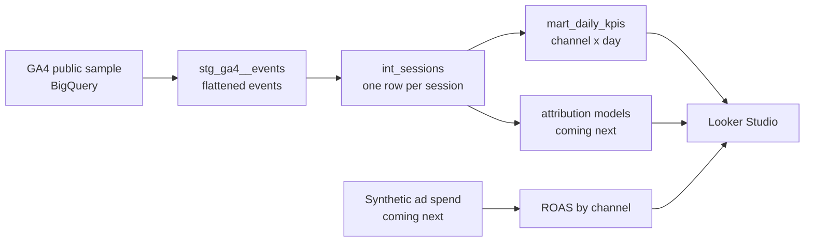

# Marketing Data Warehouse (GA4 + BigQuery + dbt)

End-to-end marketing analytics pipeline: raw GA4 event data in BigQuery is modeled with dbt into sessions, channel performance and (next) multi-touch attribution, then visualized in Looker Studio.

**Goal:** show how raw tracking data becomes trustworthy marketing KPIs — and how attribution choices change which channel "wins".

## Architecture



## Data

- `bigquery-public-data.ga4_obfuscated_sample_ecommerce` — real GA4 export from the Google Merchandise Store, Nov 2020 – Jan 2021.
- The dataset is obfuscated: some values appear as `<Other>` or `(data deleted)`. This is expected and documented in the analysis.

## Roadmap

- [x] Exploration queries (`sql/exploration/`)
- [x] dbt staging model: flattened GA4 events
- [x] dbt intermediate model: sessions with source/medium and landing page
- [x] dbt mart: daily KPIs by channel
- [ ] Attribution: first-click vs. last-click vs. linear
- [ ] Synthetic ad spend per channel + ROAS
- [ ] Looker Studio dashboard (screenshot in this README)

## Setup

1. Create a Google Cloud project and open BigQuery. The free **BigQuery sandbox** is enough (no credit card; tables expire after 60 days).
2. Run the queries in `sql/exploration/` in the BigQuery console, in order.
3. Install the tooling:
   ```bash
   python -m venv .venv && source .venv/bin/activate
   pip install -r requirements.txt
   gcloud auth application-default login
   ```
4. Copy `profiles.yml.example` to `~/.dbt/profiles.yml` and set your project ID. Keep `location: US` — the public dataset lives in the US.
5. Build:
   ```bash
   dbt debug
   dbt build
   ```

## Project structure

```
sql/exploration/   ad-hoc queries to understand the data
macros/            event_param() helper for GA4 nested params
models/staging/    1:1 cleaned source data
models/intermediate/ business entities (sessions)
models/marts/      reporting tables
```
